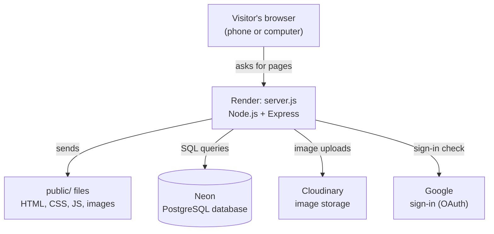

# God's Banditos — Full Build Report

**Site:** https://mulenga-mwamba-website.onrender.com
**Repository:** https://github.com/Vamp1-hunid/Website-about-me (branch `full-site`)
**Owner:** Mulenga Mwamba · **Report date:** 14 November 2026

This report explains the whole website from the ground up: how it was built, which outside
services it uses and how each account was set up, how every page and animation works, and
exactly where to go in the code to change things. It assumes you know basic HTML, CSS and
JavaScript and explains everything else as it goes.

---

## Contents

1. [What the site is](#1-what-the-site-is)
2. [How the pieces fit together](#2-how-the-pieces-fit-together)
3. [Words and abbreviations used in this report](#3-words-and-abbreviations-used-in-this-report)
4. [Map of the files](#4-map-of-the-files)
5. [How it was built, step by step](#5-how-it-was-built-step-by-step)
6. [Third-party accounts: what each one is for and how to set it up](#6-third-party-accounts)
7. [Environment variables (the settings on Render)](#7-environment-variables)
8. [The database](#8-the-database)
9. [The API (how pages talk to the server)](#9-the-api)
10. [Security: what protects the site and its members](#10-security)
11. [The theme: colours, fonts and layout](#11-the-theme)
12. [Every animation and effect: how it works and how to change it](#12-every-animation-and-effect)
13. [Reduced motion and accessibility](#13-reduced-motion-and-accessibility)
14. [Everyday tasks](#14-everyday-tasks)
15. [Running the site on your laptop](#15-running-the-site-on-your-laptop)
16. [Deploying, and fixing a failed deploy](#16-deploying-and-fixing-a-failed-deploy)
17. [Free-plan limits and known gaps](#17-free-plan-limits-and-known-gaps)

---

## 1. What the site is

**God's Banditos** is your story creation brand, and this is its website. It has five jobs:

| Job | Where |
|---|---|
| **Brand home** — logo, what the brand makes, latest works, a link to the creator | Home page `/` |
| **Creator page** — you: about, hobbies, learning plan, projects, photos, video, contact form | `/creator` |
| **Archive** — your story art, anime works and writing | `/gallery` and `/work/<name>` |
| **Community** — visitors create accounts to comment, like and save favourites | `/register`, `/login`, `/profile` |
| **Admin** — only you can post, edit, hide (draft) and delete works | `/admin` |

It started life as a single static page for ICT251 Activity 3 (one HTML file, one CSS file,
one JavaScript file). It was then rebuilt into a full website: a **server** that runs code,
a **database** that remembers accounts and posts, and **image storage** for your artwork,
all wrapped in an original theme inspired by the look of Watch Dogs 2 (no game logos,
artwork or fonts are used). Finally it was rebranded from a personal page into the God's
Banditos brand site, with your personal content moved to its own creator page.

---

## 2. How the pieces fit together



In words: the visitor's browser only ever talks to **Render**, which runs `server.js`. The
server hands out the page files, answers the `/api/...` addresses using the **Neon**
database, sends uploaded art to **Cloudinary**, and asks **Google** to confirm who someone
is when they press "Continue with Google". It also serves `/robots.txt` and `/sitemap.xml`
for Google Search.

**The journey of one page view**, for example someone opening one of your works:

1. The browser asks Render for `/work/a-year-to-burn-cover`.
2. `server.js` sends back `public/work.html`: the page's skeleton (header, footer, empty boxes).
3. The browser loads `css/styles.css` (the look) and the scripts in `js/`.
4. `js/work.js` reads the name from the address and asks the server for the details:
   `GET /api/posts/a-year-to-burn-cover`.
5. The server looks the work up in the Neon database and replies with **JSON** (plain data).
6. `js/work.js` fills the page: image (from Cloudinary), title, text, likes and comments.
7. `js/fx.js` and `js/flair.js` add the effects: profiler, glitches, tilt, and so on.

This split — **HTML skeleton + JSON data filled in by JavaScript** — is the same pattern as
your ICT251 Activity 4 CRUD app.

---

## 3. Words and abbreviations used in this report

| Term | Plain-English meaning |
|---|---|
| **HTML** (HyperText Markup Language) | The structure of a page: headings, paragraphs, forms. |
| **CSS** (Cascading Style Sheets) | The look: colours, fonts, layout, animations. |
| **JS** (JavaScript) | Code that runs in the browser and makes pages interactive. |
| **DOM** (Document Object Model) | The live, in-memory version of the page that JavaScript reads and changes. |
| **Node.js** | Lets JavaScript run on a server instead of in a browser. |
| **Express** | A Node.js library for writing web servers: "when someone asks for X, do Y". |
| **npm** (Node Package Manager) | Downloads the libraries listed in `package.json`. |
| **Server** | The computer that runs `server.js` and answers requests (here, a Render machine). |
| **Client** | The visitor's browser. |
| **API** (Application Programming Interface) | The set of addresses the pages call to get or change data, e.g. `/api/posts`. |
| **JSON** (JavaScript Object Notation) | A plain-text data format: `{"title": "Cover", "likes": 3}`. |
| **HTTP** / **HTTPS** | The language browsers and servers speak; the S means encrypted. |
| **GET / POST / PUT / DELETE** | HTTP "verbs": read, create, update, delete. |
| **Status code** | A number in every reply: 200 OK, 201 Created, 400 bad input, 401 not logged in, 403 not allowed, 404 not found, 500 server error. |
| **Route** | One address the server answers, e.g. `POST /api/account/login`. |
| **Middleware** | A function that runs before a route, e.g. "must be logged in". |
| **Database** | Permanent storage for data, organised in tables. |
| **PostgreSQL** ("Postgres") | The database system used here. |
| **SQL** (Structured Query Language) | The language for asking a database things: `SELECT * FROM posts`. |
| **Table / row / column** | A table is like a spreadsheet; a row is one record; a column is one field. |
| **Primary key** | The column that uniquely identifies a row (usually `id`). |
| **Foreign key** | A column pointing at a row in another table, e.g. a comment's `post_id`. |
| **Schema** | The list of tables and columns (`db/schema.sql`). |
| **Migration** | Code that creates or updates the tables (`src/migrate.js`). |
| **Connection string** | One line with the database's address, username and password. Secret. |
| **Environment variable** | A named setting given to the server from outside the code (on Render's Environment page). Keeps secrets out of GitHub. |
| **`.env` file** | A file of environment variables for your laptop only; never committed. |
| **Hash** / **bcrypt** | A one-way scramble of a password. The site stores the hash, never the password. bcrypt is the slow, salted hashing method used. |
| **Session** | The server's memory that "this browser is logged in as @fan_01". |
| **Cookie** | A small value the browser sends with each request; here it carries the session id. |
| **OAuth** (Open Authorization) / **OIDC** (OpenID Connect) | The standard behind "Continue with Google": Google confirms who someone is without giving your site their Google password. |
| **Client ID / client secret** | The username and password your site uses to talk to Google's sign-in service. |
| **CSRF** (Cross-Site Request Forgery) | An attack where another website tricks a visitor's browser into acting on your site. |
| **XSS** (Cross-Site Scripting) | An attack where someone sneaks code into text (e.g. a comment) so it runs on other visitors' screens. |
| **CSP** (Content Security Policy) | A header listing where a page may load scripts, fonts and images from. |
| **Rate limit** | A cap on attempts per time window (e.g. 10 logins per 15 minutes). |
| **CDN** (Content Delivery Network) | Servers around the world that deliver files fast; Cloudinary uses one. |
| **Deploy** | Putting a new version of the code live. |
| **Branch / commit / push / PR** | Git terms: a line of work / a saved change / upload to GitHub / pull request, a proposal to merge one branch into another. |
| **SEO** (Search Engine Optimisation) | Making the site easy for Google to find and list. |
| **Sitemap** | A list of the site's pages for search engines (`/sitemap.xml`). |
| **rAF** (`requestAnimationFrame`) | Asks the browser to run a function just before the next screen redraw (about 60 times a second). Used for smooth animation. |
| **Canvas** | An HTML element you draw pixels on with JavaScript (the network map). |
| **Keyframes** | A CSS animation recipe: "at 0% look like this, at 100% look like that". |
| **Transition** | A CSS rule that animates a change smoothly, e.g. on hover. |
| **Transform** | CSS that moves, rotates or scales an element without disturbing the layout. |
| **clip-path** | CSS that shows only part of an element (used for wipes and cut corners). |
| **Media query** | CSS that applies only on some screens, e.g. `@media (max-width: 760px)`. |
| **`prefers-reduced-motion`** | A device setting people turn on when motion makes them unwell; the site respects it. |
| **ARIA** (Accessible Rich Internet Applications) | HTML attributes that tell screen readers what things are, e.g. `aria-expanded`. |

---

## 4. Map of the files

**Top level**

| File | Job |
|---|---|
| `server.js` | Starts everything: security, sessions, API, pages |
| `package.json` | Start command and list of libraries |
| `package-lock.json` | Exact library versions (made by npm) |
| `.env.example` | Template for your laptop's `.env` |
| `.gitignore` | Files Git must never upload |
| `README.md` | Short guide |
| `docs/BUILD-REPORT.md` | This report |
| `db/schema.sql` | Every database table |

**`src/` — server code**

| File | Job |
|---|---|
| `env.js` | Loads `.env`; tidies pasted Render settings |
| `db.js` | The database connection |
| `migrate.js` | Creates tables; creates or resets the admin |
| `auth.js` | Login checks, log-in helper, safe redirects |
| `storage.js` | Image uploads (Cloudinary) |
| `routes/account.js` | Register, log in/out, password, delete |
| `routes/posts.js` | Works, likes, favourites, comments |
| `routes/comments.js` | Delete a comment |
| `routes/google.js` | "Continue with Google" |
| `routes/seo.js` | robots.txt, sitemap, Search Console |

**`public/` — pages**

| File | Address |
|---|---|
| `index.html` | `/` God's Banditos home |
| `creator.html` | `/creator` your page |
| `gallery.html` | `/gallery` |
| `work.html` | `/work/<name>` |
| `login.html`, `register.html` | `/login`, `/register` |
| `profile.html` | `/profile` |
| `admin.html` | `/admin` |
| `404.html` | wrong addresses |
| `Activity1.html` | your old Activity 1 page |
| `css/styles.css` | the whole look, in numbered sections |
| `images/` | photos, logo files, share card |
| `videos/` | intro video and audio |

**`public/js/` — browser scripts**

| File | Job |
|---|---|
| `theme-boot.js` | Runs first: theme, boot and wipe flags |
| `api.js` | Talks to the server; header buttons; toasts |
| `script.js` | The four ICT251 features |
| `fx.js` | Boot, network map, profiler, hack, console, reveal |
| `flair.js` | Decode, roles, tilt, bursts, reticle, wipe |
| `works-grid.js` | Builds work cards |
| `home.js` | Latest works and tile counts on the home page |
| `gallery.js` | Works page, filters, pages |
| `work.js` | One work: likes, saves, comments |
| `auth-forms.js` | Log in and Join forms |
| `profile.js` | Profile page |
| `admin.js` | Admin page |

Every page loads its scripts in the same order: `theme-boot.js` in the `<head>` (on purpose,
so the theme is right before anything is drawn), then at the end `api.js`, `script.js`,
`fx.js`, `flair.js`, then the page's own script. The later scripts use helpers the earlier
ones define (they all hang off one shared object called `window.MW`).

---

## 5. How it was built, step by step

This is the order things were actually done, so you can rebuild it from nothing or follow
what changed and why.

### Step 1 — Audit the original static site
The ICT251 page (`index.html`, `css/styles.css`, `js/script.js`) was opened live on Render and
checked in the browser. Problems found and fixed first:

| Problem | Fix |
|---|---|
| `js/effects-plus.js` was linked but didn't exist (404 error on every visit) | Removed the `<script>` line |
| Intro video was 65 MB for 30 seconds | Re-encoded with **ffmpeg** (a command-line video tool) to 720×1280, H.264, ~5.6 MB, with "fast start" so it plays before fully downloading |
| Selfie was 315 KB but shown at 140 px | Resized to 600 px wide, 68 KB |
| About section squeezed on phones | Photo stacks above the text on narrow screens |
| Floating console button covered text | Shrinks to a small `>_` square on phones |
| Missing font, stale footer date, light-mode flash, README placeholders | Fixed |

### Step 2 — Move the static site into `public/`
A server needs a folder of "files to hand to browsers". Everything the browser downloads moved
into `public/`. Paths in the HTML became absolute (`/css/styles.css` instead of
`css/styles.css`) so they work from any address, including `/work/<name>`.

### Step 3 — The server (`server.js`)
An Express server that, in order:
1. loads settings (`src/env.js`),
2. adds security headers (the **helmet** library, including the CSP),
3. reads JSON request bodies,
4. sets up login sessions stored in the database (`express-session` + `connect-pg-simple`),
5. mounts the API under `/api` (with the cross-site check `sameOriginOnly` in front),
6. mounts Google sign-in at `/auth/google`,
7. serves `robots.txt`, `sitemap.xml` and the Google verification file,
8. serves `/work/<name>` (always `work.html`), then every file in `public/`,
9. sends `404.html` for anything else,
10. catches unexpected errors (visitors see a short message; details go to Render's logs),
11. runs the database migration, then starts listening.

### Step 4 — The database (`db/schema.sql`, `src/db.js`, `src/migrate.js`)
Tables for users, posts, comments, likes, favourites, sessions and a small settings table
(section 8). Every statement uses `IF NOT EXISTS`, so the migration runs safely on **every**
start: nothing is created twice, and new columns are added automatically after an update.

### Step 5 — Accounts (`src/routes/account.js`, `src/auth.js`)
Register, log in, log out, "who am I?", favourites, stats, change password, delete account.
Passwords are hashed with bcrypt; logging in gives the browser a fresh session id.

### Step 6 — Works, likes, favourites, comments (`src/routes/posts.js`, `comments.js`)
The admin-only create/edit/delete endpoints accept a form with an image file. Members can
like, save and comment. Drafts (unpublished works) are invisible to everyone but you.

### Step 7 — Image uploads (`src/storage.js`)
Uploads go through **multer** (reads the file, max 8 MB, images only), get checked byte-by-byte
to make sure they really are images, then go to **Cloudinary**. Cloudinary also makes
smaller copies on the fly for the gallery cards.

### Step 8 — The pages
Every page shares the same header, navigation and footer. The data-driven pages are
skeletons that their scripts fill in from the API.

### Step 9 — The theme (`css/styles.css`)
A complete rewrite of the stylesheet into numbered sections with all colours and fonts in
variables, so the light theme only swaps values.

### Step 10 — Effects (`js/fx.js`)
Boot screen, network map, profiler, hold-to-hack, console, scroll reveal, glitch and the
"hack" easter egg.

### Step 11 — Testing
Each stage was tested in a real (headless) Chrome against a real PostgreSQL database, on
desktop and phone sizes, plus with "reduce motion" switched on: forms, permissions
(members can't reach admin), XSS (a comment containing `<script>` shows as text),
uploads, edit, draft, delete, and the four ICT251 features.

### Step 12 — Deployment
GitHub → Render Web Service → Neon + Cloudinary (section 6). The first deploy failed: a
pasted setting with extra text crashed the Cloudinary library at start-up. `src/env.js` was
added to tidy pasted values and ignore an unusable Cloudinary value instead of crashing.

### Step 13 — Passwords
A **Change password** form on `/profile`. `ADMIN_PASSWORD` on Render works as a reset: only a
*changed* value resets the admin password, so normal restarts never undo a password you set
on the site.

### Step 14 — Google sign-in and Google Search
"Continue with Google" on the login and join pages, linking on the profile page, plus
`robots.txt`, `sitemap.xml`, page descriptions and the Search Console verification route.

### Step 15 — Caching fix
The server had told browsers to keep pages for an hour, so visitors saw old pages after an
update. HTML, CSS and JS are now re-checked on every visit (a quick "not modified" reply when
nothing changed); photos and video are still kept for a week.

### Step 16 — Animation layer (`js/flair.js`)
Decoding text, rotating roles, tapes, tilt, pixel bursts, access stamp, reticle, page wipe,
scroll progress — then titles were made to glitch on **every** hover, not just the first.

### Step 17 — Phone fit
Every page was measured at 360 px and 390 px wide. Grids now shrink to any width
(`minmax(min(260px, 100%), 1fr)`), the learning-plan table becomes stacked cards on phones,
long words wrap, and checkboxes got bigger. No page scrolls sideways.

### Step 18 — Rebrand to God's Banditos
The home page became the brand page; the personal sections moved to `/creator`. Your logo
was redrawn as an SVG in the site's own pink and cyan (section 11.4), and the name was
changed in titles, boot screen, console, page wipe, tapes, footer and sitemap. A share card
(`og-card.png`) was made for link previews.

---

## 6. Third-party accounts

The site uses six outside services. All are free at this size. **Secrets (passwords, keys,
connection strings) go only into Render's Environment page — never into the code, GitHub or
a chat.**

### 6.1 GitHub — stores the code
- **What it's for:** keeps every version of the code; Render builds the site from it.
- **Set-up:** account `Vamp1-hunid`, repository `Website-about-me`.
- **Branches:** `main` still holds the original static site (your old Render static site
  builds from it). `full-site` holds this website; the new Render service builds from it.
  Pull request #5 proposes merging `full-site` into `main`.
- **Claude GitHub app:** installed on the repository so Claude could push the work. You can
  remove it any time: GitHub → Settings → Applications → Installed GitHub Apps → Claude.

### 6.2 Render — runs the server
- **What it's for:** hosts the Node.js server on the internet at
  `https://mulenga-mwamba-website.onrender.com`.
- **How it was set up:**
  1. Render dashboard → **New → Web Service** → repository `Vamp1-hunid/Website-about-me`.
  2. Name `mulenga-mwamba-website` (this becomes the address), language **Node**,
     branch `full-site`, region Oregon.
  3. Build command `npm install`, start command `npm start`.
  4. Instance type **Free** (Render pre-selects a paid plan; it was switched to $0).
  5. Environment variables added (section 7). `SESSION_SECRET` and `ADMIN_PASSWORD` were
     filled with Render's **Generate** button so nobody had to type them.
- **Auto-deploy:** every push to `full-site` rebuilds and redeploys (2–4 minutes).
- **Useful tabs:** **Events** (deploy history), **Logs** (server messages and errors),
  **Environment** (settings), **Manual Deploy → Deploy latest commit**.

### 6.3 Neon — the PostgreSQL database
- **What it's for:** permanently stores accounts, works, comments, likes, favourites and
  login sessions. Chosen over Render's own database because Render deletes free databases
  after 30 days; Neon's free tier doesn't expire.
- **Project:** `aged-base-76610693` (organisation `org-red-surf-29786337`), database `neondb`.
- **How to get the connection string:** Neon console → your project → **Connect** (top
  right) → keep "Connection pooling" on → click the **copy** icon (the text box hides the
  password as `****`; the copy icon copies the real one). It starts with
  `postgresql://neondb_owner:` and ends with `?sslmode=require&channel_binding=require`.
- **Where it goes:** Render → Environment → `DATABASE_URL`.
- **If the password ever leaks:** Neon → Connect → **Reset password**, then paste the new
  string into Render.
- **You never create tables by hand:** the server does it on start (`src/migrate.js`).

### 6.4 Cloudinary — image storage
- **What it's for:** stores your uploaded artwork permanently and serves it fast. Needed
  because Render's free servers have no permanent disk: anything saved on them is wiped
  whenever the service restarts (which happens every time it wakes from sleep).
- **Set-up:** free account at cloudinary.com → gear icon (Settings) → **API Keys**. Copy the
  **API environment variable**; it's shown as a template
  `cloudinary://<your_api_key>:<your_api_secret>@<cloud_name>` — replace the two
  `<...>` parts with the real key and secret listed on the same page.
- **Where it goes:** Render → Environment → `CLOUDINARY_URL`.
- **What the code does with it:** uploads go to a folder `mwamba-site`; gallery cards ask
  Cloudinary for a 720-pixel copy (`thumbnailUrl` in `src/storage.js`); deleting or replacing a
  work's image deletes the old file from Cloudinary too.
- **Without it:** the site still works, but uploaded images disappear on restart.

### 6.5 Google Cloud — "Continue with Google"
- **What it's for:** lets people sign up and log in with their Google account.
- **Set-up (once):**
  1. https://console.cloud.google.com → create a project (any name).
  2. The consent screen (labelled **Google Auth Platform → Branding**, or "OAuth consent
     screen"): app name, support email, audience **External**. Then **Publish** the app —
     while it's in "Testing", only test users you list can sign in.
  3. **Clients → Create client → Web application.** Under **Authorised redirect URIs** add
     exactly `https://mulenga-mwamba-website.onrender.com/auth/google/callback`
     (if the site address ever changes, this must change too).
  4. Copy the **Client ID** and **Client secret** into Render as `GOOGLE_CLIENT_ID` and
     `GOOGLE_CLIENT_SECRET`, then deploy. The Google buttons appear by themselves.
- **Scopes asked for:** `openid email profile` (name and email only — no access to Gmail,
  Drive or anything else), so Google doesn't require an app review.

### 6.6 Google Search Console — showing up in Google Search
- **What it's for:** tells Google your site exists, proves you own it, and shows search stats.
- **Set-up:**
  1. https://search.google.com/search-console → **Add property** → **URL prefix** → your address.
  2. Method **HTML file**: Google names a file like `google1a2b3c4d.html`. Don't upload it —
     put its name (`google1a2b3c4d`) into Render as `GOOGLE_VERIFICATION`, deploy, then click
     **Verify**. The server answers that address itself (`src/routes/seo.js`).
  3. **Sitemaps** → submit `sitemap.xml`.
- It usually takes days to a couple of weeks before searching your name finds the site.

---

## 7. Environment variables

Set on Render → your service → **Environment**. After changing any of them, deploy again.

| Name | Required? | What it is |
|---|---|---|
| `NODE_ENV` | yes | `production` on Render. Turns on HTTPS-only cookies and strict checks. |
| `DATABASE_URL` | yes | Neon connection string. |
| `SESSION_SECRET` | yes | Long random value that signs login cookies (32+ characters). Changing it logs everyone out. |
| `ADMIN_USERNAME` | yes | Your admin login, `mwamba`. |
| `ADMIN_PASSWORD` | yes | Used to create the admin account the first time. Afterwards, changing it **resets** your admin password (and signs your admin sessions out). |
| `ADMIN_DISPLAY_NAME` | no | Name shown on your comments; default "Mulenga Mwamba". |
| `CLOUDINARY_URL` | strongly recommended | Cloudinary connection. |
| `GOOGLE_CLIENT_ID`, `GOOGLE_CLIENT_SECRET` | no | Turn on Google sign-in. |
| `GOOGLE_VERIFICATION` | no | Search Console file name, e.g. `google1a2b3c4d`. |
| `PUBLIC_URL` | no | Only if you add your own domain (e.g. `https://mwamba.dev`); used for the Google redirect and the sitemap. |

`src/env.js` trims spaces, strips quotes or a `NAME=` prefix, and pulls the real value out of
a pasted `psql '...'` command, so a messy paste can't crash the server.

---

## 8. The database

Defined in `db/schema.sql`, created by `src/migrate.js` on every start.

| Table | One row is... | Key columns |
|---|---|---|
| `users` | an account | `username` (unique), `display_name`, `password_hash` (empty for Google-only accounts), `role` (`admin` or `member`), `google_sub` (Google's id for the person), `email` |
| `posts` | one work | `slug` (the address name, unique), `category` (`story-art`, `anime`, `writing`), `title`, `summary`, `body`, `image_url`, `image_public_id`, `published` |
| `comments` | one comment | `post_id` → posts, `user_id` → users, `body` |
| `likes` | "this member likes this work" | `user_id` + `post_id` together are the primary key, so nobody can like twice |
| `favourites` | "this member saved this work" | same pattern as likes |
| `user_sessions` | one logged-in browser | managed by `connect-pg-simple` |
| `app_settings` | a server setting | stores a hash of the last applied `ADMIN_PASSWORD` |

`ON DELETE CASCADE` on the foreign keys means deleting a work also deletes its comments, likes
and favourites, and deleting an account removes everything that member posted.

To look at the data directly: Neon console → **Tables** (browse), or **SQL Editor**, e.g.
`SELECT username, role, created_at FROM users ORDER BY created_at DESC;`

---

## 9. The API

Everything under `/api` speaks JSON. 🔒 = must be logged in, 👑 = admin only.

| Method and address | Does |
|---|---|
| `GET /api/health` | `{"ok":true}` — quick "is the server up?" check |
| `POST /api/account/register` | Create a member account `{username, displayName, password}` |
| `POST /api/account/login` | Log in `{username, password}` |
| `POST /api/account/logout` | Log out |
| `GET /api/account/me` | Who is logged in (or `null`), and whether Google sign-in is on |
| `GET /api/account/favourites` 🔒 | Your saved works |
| `GET /api/account/stats` 🔒 | Joined date, counts, has-password, Google-linked |
| `POST /api/account/password` 🔒 | Change (or first set) your password |
| `POST /api/account/google/unlink` 🔒 | Stop using Google sign-in (needs a password first) |
| `DELETE /api/account` 🔒 | Delete your account (members only) |
| `GET /api/posts?category=&page=` | List published works, 12 per page |
| `GET /api/posts/<slug>` | One work, plus whether *you* liked/saved it |
| `GET /api/posts/by-id/<id>` 👑 | One work by number, drafts included (edit form) |
| `POST /api/posts` 👑 | New work (form with optional `image` file) |
| `PUT /api/posts/<id>` 👑 | Edit a work |
| `DELETE /api/posts/<id>` 👑 | Delete a work and its image |
| `POST`/`DELETE /api/posts/<id>/like` 🔒 | Like / unlike |
| `POST`/`DELETE /api/posts/<id>/favourite` 🔒 | Save / unsave |
| `GET /api/posts/<id>/comments` | Comments on a work |
| `POST /api/posts/<id>/comments` 🔒 | Add a comment |
| `DELETE /api/comments/<id>` 🔒 | Delete a comment (your own; the admin can delete any) |

Outside `/api`: `/auth/google` and `/auth/google/callback` (Google sign-in), `/robots.txt`,
`/sitemap.xml`, `/google<code>.html`.

On the browser side, `MW.api(path, options)` in `js/api.js` wraps `fetch`: it sends JSON or
form data, reads the reply, and turns errors into a message you can show.

---

## 10. Security

| Threat | Protection | Where |
|---|---|---|
| Stolen password list | Passwords stored as **bcrypt** hashes (cost 12), never in plain text | `account.js`, `migrate.js` |
| Password guessing | 10 login attempts per 15 minutes per visitor; same message for wrong username or password (and a dummy hash check so timing doesn't leak which one) | `account.js` |
| Spam sign-ups / comments | 5 sign-ups per hour; 20 comments per 10 minutes | `account.js`, `posts.js` |
| Session hijacking | Cookie is `httpOnly` (scripts can't read it), `secure` (HTTPS only), `sameSite=lax`; a new session id at every login | `server.js`, `auth.js` |
| CSRF | `sameSite` cookies **plus** `sameOriginOnly`: any change request with another site's `Origin` header is refused | `auth.js` |
| XSS | Everything visitors type is put on the page with `textContent`, never `innerHTML`; the CSP blocks scripts from anywhere but the site itself | all page scripts, `server.js` |
| SQL injection | Every query uses placeholders (`$1, $2`) so values are never mixed into SQL text | all routes |
| Fake image uploads | Only admins can upload; type, size (8 MB) **and** the file's first bytes are checked | `storage.js` |
| Open redirects | `?next=` only accepts addresses on this site | `auth.js` (`safeNext`), `api.js` |
| Google sign-in tampering | Random `state` (checked in constant time) and `nonce`; Google's token signature and audience verified by Google's official library | `google.js` |
| Members reaching admin tools | Every admin route checks the role on the server; hiding the admin page is only for convenience | `auth.js`, `posts.js` |
| Secrets in GitHub | All secrets are environment variables; `.env` is in `.gitignore` | `.gitignore` |
| Search engines listing private pages | `noindex` on login/join/profile/admin; `robots.txt` blocks them | pages, `seo.js` |

---

## 11. The theme

### 11.1 Colours
All colours live in **variables** at the top of `public/css/styles.css` (section 1). The rest of
the stylesheet only ever says `var(--pink)` and so on, so changing a colour in one place
changes it everywhere.

| Variable | Dark theme | Light theme | Used for |
|---|---|---|---|
| `--bg` | `#0b0a10` near-black | `#f4f1ea` paper | page background |
| `--panel` | `#15131d` | `#ffffff` | section boxes |
| `--ink` / `--ink-dim` | off-white / grey-violet | near-black / grey | text |
| `--pink` | `#ff2e97` | `#d1006b` | main accent, buttons, brackets |
| `--cyan` | `#19e3ff` | `#006a80` | second accent, links, hover |
| `--yellow` | `#ffe23d` | `#ffd60a` | stickers, tape |
| `--success` / `--error` | green / red | darker versions | messages |
| `--map-node`, `--map-line` | `r, g, b` numbers | | network map colours (written as numbers because the canvas adds its own transparency) |

The light theme is the block `:root[data-theme="light"] { ... }`. The theme button
(`js/script.js`) only switches the `data-theme` attribute on `<html>`; CSS does the rest.
`js/theme-boot.js` re-applies a saved light theme before the page is drawn, so there's no flash.

**To recolour the site:** change the hex values in section 1 (and in the light block). Keep
text readable: light text on dark backgrounds needs a contrast ratio of at least 4.5 : 1 — check
with any online "contrast checker".

### 11.2 Fonts
Three free Google Fonts, loaded in every page's `<head>`:

| Variable | Font | Used for |
|---|---|---|
| `--font-display` | **Bungee** (blocky street lettering) | your name, big page titles, boot logo, stamp |
| `--font-ui` | **Chakra Petch** (techy sans-serif) | body text, section headings, buttons |
| `--font-mono` | **Share Tech Mono** (terminal look) | labels, stickers, console, HUD text |

To swap one: pick a font on fonts.google.com, replace its name in the `<link href=...>` line of
**every** HTML page, and in the matching variable.

### 11.3 Shapes and layout ideas
- **Cut corners** on buttons and stickers: `clip-path: polygon(...)` slices the corners off;
  the size is `--cut` (section 1).
- **HUD corner brackets** on each section: `.panel::before` (pink, top-left) and
  `.panel::after` (cyan, bottom-right), section 5.
- **Halftone dots** behind the page: a tiny `radial-gradient` repeated every 14 px on `body`.
  Its colour is `--halftone`.
- **Scanlines:** `body::after`, a very faint repeating stripe over the whole screen (dark theme only).
- **Stickers:** `.sticker`, slightly rotated with a clipped corner (section 7). Category colours:
  story art = yellow, anime = cyan, writing = white with a pink outline.
- **Node labels** like "NODE 02 // DOSSIER" above each heading: `.node-label` (section 5).

### 11.4 The God's Banditos logo
Your original logo (masked bandit, halo, circuit lines, purple-to-blue lettering) was redrawn
by hand as **SVG** (Scalable Vector Graphics — a picture described as shapes, so it stays sharp
at any size) in the site's own colours:

| File | What | Used in |
|---|---|---|
| `images/gods-banditos-mark.svg` | Full mark: halo, mask, eyes, scar, circuits, neon glow | Home page logo, boot screen, share card |
| `images/gods-banditos-icon.svg` | Simplified: halo, mask, eyes only (circuits turn to mush when tiny) | Header, footer, browser tab |
| `images/gods-banditos-icon-180.png` | The icon as a picture | Phone home-screen shortcut |
| `images/og-card.png` | 1200 × 630 card with logo, name and tape | Link previews on WhatsApp, Facebook, X |

Colours in the mark: halo and right-hand circuits cyan `#19e3ff`; mask, eyes, scar and
left-hand circuits pink `#ff2e97`. The glow is an SVG `filter` (a blurred copy layered under
the shapes). The mask is filled with the page colour so the circuits disappear behind it.

The **name** isn't part of the image: it's real text (the `h1.wordmark` on the home page) in
Bungee with a pink → violet → cyan gradient (`background-clip: text`), so it can decode,
glitch, and be read by search engines and screen readers.

**To edit the logo:** open the `.svg` in a text editor — each part is labelled in a comment —
or in a free editor such as Inkscape. Change a colour by editing its `stroke="#..."`. If you
change the logo, also regenerate `og-card.png` and the 180 px icon (any image editor can export
a PNG from the SVG).

---

## 12. Every animation and effect

Two files make the motion:
- `js/fx.js` — the original effects (boot, network map, profiler, hold-to-hack, console, reveal).
- `js/flair.js` — the extra layer (decode, roles, tapes, tilt, bursts, stamp, reticle, wipe).

Each script runs every effect inside a `safe(...)` wrapper, so if one breaks, the others still
work, and the site itself never depends on them. **To switch an effect off completely**, delete
or comment out its line at the bottom of the file, e.g. `// safe(initReticle);`.

For each effect below: **what you see → how it works → what to change.**

---

### 12.1 Boot screen — `fx.js` `runBoot`, CSS section 18
**You see:** on the first visit to the home page, a black screen shows the God's Banditos
logo, types four lines ("connecting to the banditos network…", "ACCESS GRANTED") with a
pink-to-cyan bar, then fades.

**How it works:**
1. `theme-boot.js` (in the `<head>`, before anything is drawn) adds the class `is-booting` to
   `<html>` if this is the home page, the visitor hasn't seen it this visit (`sessionStorage`),
   and they haven't asked for reduced motion.
2. CSS shows `.boot` only while `html.is-booting` is set.
3. `runBoot` types the lines two characters at a time (every 18 ms, with a 160 ms pause after
   each line), moves the bar, then removes the class.
4. Any key or tap skips it. A CSS **fail-safe** (`animation: boot-failsafe ... 6s`) hides it
   after 6 seconds even if JavaScript breaks.

**Change:** the text is the `lines` array in `runBoot`. Typing speed: the `18` (ms per step) and
`charIndex += 2` (characters per step). Show it every time instead of once per visit: delete the
`sessionStorage` check in `theme-boot.js`. Force it while testing: add `?boot=1` to the address.

---

### 12.2 Network map — `fx.js` `initNetMap`, CSS section 3
**You see:** faint pink dots drifting behind the page, joined by cyan lines when close; lines
near your mouse glow brighter; now and then a "data packet" runs along a line.

**How it works:**
- A `<canvas>` fixed behind everything (`#net-map`). Each frame clears it and redraws all dots.
- Number of dots = screen area ÷ 26,000, between 18 and 64 (so phones get fewer).
- Each dot moves a little every frame and wraps around the edges. Two dots closer than
  150 px get a line whose transparency fades with distance.
- Scrolling shifts the dots slightly (a parallax effect).
- It draws at most ~30 times a second (`time - lastFrame > 33`), pauses when the tab is hidden,
  and re-reads its colours when the theme changes.

**Change:** density `26000` (smaller = more dots); link distance `maxDist = 150`; speed is the
`* 0.18` in `vx`/`vy`; brightness is `opacity` on `#net-map` in CSS section 3 (`0.8` dark,
`0.5` light). Colours: `--map-node`, `--map-line`.

---

### 12.3 Profiler — `fx.js` "3. PROFILER", CSS section 15
**You see:** pointing at (or tapping) your photos or any work shows a dark scan card with a
cyan scan line: name, then rows like OCCUPATION, LOCATION, FACT.

**How it works:**
- Any element with a `data-profile` attribute is a target. The attribute holds JSON:
  ```html
  <figure data-profile='{
    "name": "Gaming session",
    "kicker": "SCAN",
    "id": "CAM 02",
    "rows": [
      ["ACTIVITY", "Two controllers"],
      ["FACT", "Top hobby"]
    ]}'>
  ```
  Work cards are registered from JavaScript with `MW.profile(element, data)` (`works-grid.js`,
  `work.js`).
- One shared card element is moved next to whichever target is active (right side if it fits,
  otherwise left, otherwise below/above) and kept beside it while you scroll.
- Mouse: opens on hover. Keyboard: opens on focus. Touch: a tap toggles it.
- Screen readers get the same details as hidden text (`aria-describedby`).

**Change the details:** edit the `data-profile` JSON in `index.html` (About photo and the four
gallery photos). Keep the quotes exactly as they are — in HTML the JSON's `"` are written
`&quot;`; the easiest way is to copy an existing one and change only the words.
**Look:** CSS section 15 (`.profiler`, `.profiler-head`, `.profiler-name`).

---

### 12.4 Hold to hack — `fx.js` "4. HOLD-TO-HACK", CSS section 16
**You see:** each project card has a **HOLD TO HACK** button with a ring. Press and hold: the
ring fills; at full, the hidden notes open, the button turns green ("ACCESS GRANTED") and the
card gets a stamp and pixel burst (12.14).

**How it works:**
- The ring is a `conic-gradient` (a pie chart) whose filled angle is the CSS variable
  `--progress` (0 to 1), turned into a ring with a circular `mask`.
- On `pointerdown`, a `requestAnimationFrame` loop sets `--progress` = time held ÷ `HOLD_MS`.
  Letting go early resets it. At 1, the panel named in `aria-controls` is un-hidden and
  `aria-expanded` becomes `true`.
- A keyboard press (Enter/Space) opens it straight away — holding isn't fair to keyboard users.
- Pressing an open file closes it.

**Change:** hold time `HOLD_MS = 800` (milliseconds). Notes: the `hack-reveal` blocks in
`index.html`. Add the feature to any new card by copying a whole `.card` block — the button's
`aria-controls` must match the notes block's `id`.

---

### 12.5 Console — `fx.js` "5. CONSOLE", CSS section 17
**You see:** the `>_ CONSOLE` button (bottom right) opens a terminal. Commands: `help`,
`whoami`, `goto <section>`, `creator`, `works [art|anime|writing]`, `theme [dark|light]`,
`login`, `hack`, `clear`. `goto` knows which page a section is on (e.g. `goto contact` opens
the creator page at the contact form).

**How it works:** the console is built by JavaScript on every page (no HTML needed).
`runCommand` splits what you typed into a command and an argument and runs the matching
`case` in a `switch`. `MW.log(text, type)` prints a line (types `ok`, `warn`, `info`, `you`
pick the colour).

**Add a command:** add a `case` inside `runCommand`, e.g.
```js
case "github":
  window.open("https://github.com/Vamp1-hunid",
              "_blank", "noopener");
  MW.log("OPENING GITHUB", "ok");
  break;
```
and add its name to the `help` line. Sections for `goto` are listed in `SECTIONS`; the ones
that live on the creator page are also in `CREATOR_SECTIONS`.

---

### 12.6 Section scanner wipe — `fx.js` `initReveal`, CSS section 20
**You see:** each section opens from left to right as it scrolls into view, a cyan scan line
sweeps across it, then the corner brackets grow in.

**How it works:**
- Sections with the class `reveal` start hidden with `clip-path: inset(0 100% 0 0)` (everything
  cut away from the right).
- An **IntersectionObserver** (a browser feature that reports when an element enters the screen)
  adds `is-in` when 8 % of a section is visible.
- `is-in` changes the clip to `inset(-80px ...)` (nothing cut, with room for shadows); the
  `transition` animates the change. The scan line is a gradient `background-image` whose
  position is animated (`@keyframes scan-sweep`). The brackets animate their width/height with
  a 0.6 s delay.
- Fail-safe: after 4 seconds every section is shown anyway. Without JavaScript, nothing is hidden
  at all (the hiding rules need the `fx` class that JavaScript adds).

**Change:** wipe speed `0.75s` in `html.fx .reveal`; scan speed `0.9s` in
`html.fx .panel.reveal.is-in`. Make a section reveal: add `reveal` to its `class`.

---

### 12.7 Glitch — `fx.js` `glitch()`, CSS section 6
**You see:** a text "jolt": the element jumps sideways and parts of it are briefly cut off,
with pink and cyan copies behind it.

**How it works:**
- The pink/cyan shadow is permanent on `.glitch` elements (`text-shadow: -2px 0 pink, 2px 0 cyan`).
- `MW.glitch(element)` adds the class `is-glitching` for 0.36 s. That runs
  `@keyframes glitch-jolt`: 3 steps of `translate` + `clip-path: inset(...)`.
- It's used by: titles on hover (12.10), the hero micro-glitch (12.11), liking a work, the
  "hack" command, and hacked project cards.

**Change:** the keyframes `glitch-jolt` (how far it moves, which slices are cut) and `0.32s`.

---

### 12.8 Decode text — `flair.js` `decode()`
**You see:** your name and section headings appear as random symbols that lock into the real
letters from left to right.

**How it works:** for each animation frame, letters before the "settled" point show their real
character and the rest show a random one from `GLYPHS`. The settled point moves from 0 to the
end over the duration. While scrambling, the real text is given to screen readers via
`aria-label`.
- Headings with the attribute `data-decode` decode when they first scroll into view (your name
  waits for the boot screen).
- Every title also decodes again whenever you point at it (12.10).

**Change:** symbols: `GLYPHS`. Speed: the durations passed to `decode(...)` (1000 ms for the name,
650 ms for headings on reveal). Add the effect to a heading: put `data-decode` on it (plain text
only — headings containing links or icons are skipped on purpose).

---

### 12.9 Rotating roles — `flair.js` `initRoles`
**You see:** on the home page, `banditos --make "..."` cycles through story art → anime works
→ fantasy stories → original characters → written chapters. On the creator page,
`whoami --role "..."` cycles through data science student → story artist → anime watcher →
gamer → web developer in training → future unicorn in tech.

**How it works:** the list is stored on the element as JSON:
`<span class="role-cycle" data-roles='["data science student", ...]'>`. A chain of timers
removes one letter every 28 ms, waits 260 ms, types the next role (55–100 ms per letter, a
little random so it feels human), waits 2.2 s, and repeats. Screen readers hear the whole list
once instead of the typing.

**Change:** edit the list in `index.html` (brand) or `creator.html` (you): the `data-roles`
attribute on `.role-cycle`. Inside the HTML the quotes are written `&quot;`. Timing: `wait(28, erase)`, `55 + Math.random() * 45`,
`wait(2200, erase)`. Caret: `.role-cycle.is-typing::after` in CSS section 23.

---

### 12.10 Titles glitch on every hover — `flair.js` `initTitleHover`
**You see:** pointing at any page title, section heading, project title or work title makes it
glitch and re-decode — every time, not only the first time.

**How it works:** one listener on the whole document watches `pointerover`. If the pointer has
just entered something matching `TITLE_SELECTOR` (and wasn't already inside it), it calls
`MW.glitch()` and `decode()` on it. A heading that's still decoding is skipped, so wiggling the
mouse doesn't stack effects. The header brand only glitches (it has two coloured parts, which
decoding would flatten). Mouse only — no effect on touch screens.

**Change:** which elements: `TITLE_SELECTOR = "h1, h2, .card h3, .work-card h3"`. Speed: the
`600` / `420` durations in `initTitleHover`.

---

### 12.11 Micro-glitch on your name — `flair.js` `initMicroGlitch`
**You see:** every 6.5–11.5 seconds, your name gives a small glitch on its own.

**How it works:** a timer that calls `MW.glitch()` on the hero heading, then sets itself again
with a random delay. Skipped while the tab is hidden or the name is decoding.

**Change:** `6500 + Math.random() * 5000` (minimum wait + random extra, in milliseconds).
Keep it at least a few seconds apart: frequent flashing effects can trigger seizures.

---

### 12.12 Sticker tapes, signal bars, sticker slap — CSS section 23
**You see:** two tapes (yellow and pink) crossing the bottom of the home page intro
("GOD'S BANDITOS ✦ STORY ART ✦ ..."), scrolling in opposite directions; animated signal bars on the "Status // building" sticker; stickers that "slap" on.

**How it works:**
- **Tapes:** each `.tape` holds the same text twice, side by side, in two `<span>`s. Both slide
  left by exactly their own width (`@keyframes tape-scroll`, `translateX(-100%)`); when the
  first copy leaves, the second is exactly where the first started, so the loop is seamless.
  The tapes are rotated (`-2.2deg`, `1.6deg`) and hidden from screen readers.
- **Signal bars:** four `<i>` bars of increasing height that fade in turn (`@keyframes signal`,
  with `animation-delay` 0, 0.15, 0.3, 0.45 s).
- **Sticker slap:** `@keyframes sticker-slap` scales from 1.8× and −14° down to normal with a
  springy `cubic-bezier(0.2, 1.6, 0.4, 1)` (the 1.6 makes it overshoot, then settle).

**Change:** tape words — the text inside `.tapes` in `index.html` (keep both spans identical).
Tape speed: `tape-scroll 38s` (yellow) and `46s` (pink); smaller = faster. Tilt: the `rotate()`
values in `.tape-yellow` / `.tape-pink`.

---

### 12.13 3-D tilt and glare — `flair.js` `initTilt`, CSS section 23
**You see:** project cards, work cards, photos, hobby chips and profile stats lean towards your
mouse, lift up, get a pink offset shadow and a soft light reflection.

**How it works:**
- On mouse move over an element matching `TILT_SELECTOR`, the script works out where the
  pointer is inside it (−0.5 to +0.5 across and down) and sets CSS variables `--tilt-x`,
  `--tilt-y` (degrees) and `--glare-x`, `--glare-y` (percent). It does this at most once per
  frame (`requestAnimationFrame`).
- CSS turns those into a 3-D turn:
  ```css
  transform: perspective(900px)
             rotateX(var(--tilt-x))
             rotateY(var(--tilt-y))
             translateY(-3px);
  ```
  `perspective` is what makes it look 3-D (smaller = more dramatic).
- The glare is a `radial-gradient` in `::after`, centred at `--glare-x/--glare-y`.
- Only on devices with a real mouse (`(hover: hover) and (pointer: fine)`).

**Change:** strength — `strength = ... ? 10 : 7` (degrees). Which elements — `TILT_SELECTOR`.
Depth — `perspective(900px)`. Glare brightness — `rgba(255, 255, 255, 0.16)` in `.tilt::after`.

---

### 12.14 Pixel bursts and the ACCESS GRANTED stamp — `flair.js` `burst`, `initStamps`
**You see:** clicking a button or link throws 8 little square pixels (pink, cyan, yellow, green)
that fly out and fall. Hacking a project file throws 16 and stamps "ACCESS GRANTED" over the card.

**How it works:**
- Each pixel is a tiny `<span class="pixel">` placed at the click point. The **Web Animations
  API** (`element.animate(...)`) moves it outward at an angle with a little extra downward drift
  ("gravity"), shrinks and fades it, then removes it.
- A `MutationObserver` (a browser feature that reports attribute changes) watches each hack
  button's `aria-expanded`. When it turns `true`, the stamp is added and removed after 1.9 s.
  The stamp's slam-and-fade is `@keyframes stamp`.

**Change:** colours `COLOURS`; click burst `burst(x, y, 8, 46)` (count, spread in px); stamp
burst `burst(..., 16, 80)`; stamp words in `initStamps`; stamp look `.stamp` in CSS section 23.

---

### 12.15 Thumbnail colour-split, button shine, nav underline — CSS section 23
- **Work thumbnails** (`@keyframes thumb-jolt`): on hover the image jumps in three steps with
  pink and cyan `drop-shadow` copies — a quick colour split.
- **Button shine** (`@keyframes shine`): a skewed white gradient in `.btn::after` slides across
  the button once on hover.
- **Nav underline:** `.site-nav a::after` is a 2 px bar with `transform: scaleX(0)`; on hover it
  becomes `scaleX(1)`, growing from the left.

**Change:** durations in each rule; shine brightness `rgba(255, 255, 255, 0.45)`.

---

### 12.16 Targeting reticle — `flair.js` `initReticle`, CSS section 23
**You see:** a pink ring with crosshair ticks trailing your mouse (desktop only). Over anything
clickable it grows and turns cyan; it shrinks while you click. Your normal cursor stays visible.

**How it works:** the script remembers where the mouse is; each frame the ring moves 22 % of the
remaining distance towards it (`rx += (x - rx) * 0.22`), which gives a smooth trailing lag. The
loop stops itself once the ring has caught up, so it costs nothing while the mouse is still.
Classes `is-hot` (over links/buttons/inputs/profiler targets) and `is-down` change its size and
colour through CSS transitions.

**Change:** lag `0.22` (smaller = lazier); size and colours in `.reticle`, `.reticle.is-hot`,
`.reticle.is-down`. Remove it: delete `safe(initReticle);`.

---

### 12.17 Page wipe between pages — `flair.js` `initPageWipe`, `theme-boot.js`, CSS section 23
**You see:** clicking a link to another page of the site slides a striped
"GOD'S BANDITOS ▸ ROUTING" cover across the screen; the next page slides it away.

**How it works:**
1. On a click on a link to another page *of this site* (not new tabs, downloads, links to a
   section on the same page, Google sign-in, or images), the script stops the browser from
   leaving, sets `sessionStorage "mw-wipe"`, adds `is-wiping wipe-in` to `<html>` and leaves
   230 ms later.
2. The cover is `html.is-wiping::after` — a fixed, full-screen pseudo-element with diagonal
   stripes. `wipe-in` animates its `clip-path` from fully cut to fully shown.
3. On the new page, `theme-boot.js` sees `mw-wipe` and adds `is-wiping` *before the page is
   drawn*, so it starts covered. `flair.js` then adds `wipe-out`, which slides the cover away.
4. Fail-safes: the cover hides itself after 1.5 s even if JavaScript fails, and the Back button
   (which can restore a page from memory) clears it too.

**Change:** delay before leaving `230` (ms); text — the `content:` in `html.is-wiping::after`;
stripes — the `repeating-linear-gradient`. Turn off — delete `safe(initPageWipe);` and the
"mw-wipe" block in `theme-boot.js`.

---

### 12.18 Scroll progress bar — `flair.js` `initProgress`, CSS section 23
**You see:** a 3 px pink-yellow-cyan bar along the very top that grows as you scroll.

**How it works:** on scroll (at most once per frame) it sets
`transform: scaleX(scrolled ÷ (page height − window height))`. `scaleX` stretches the bar from
the left (`transform-origin: left`) without making the browser redo the page layout.

**Change:** thickness `height: 3px` and colours in `.scroll-progress`.

---

### 12.19 Smaller effects
| Effect | Where | Notes |
|---|---|---|
| Logo float and glow on the home page | CSS section 24 `.hero-logo` | `@keyframes logo-float`, 5 s: drifts up 8 px and the glow shifts pink → cyan |
| Profiler on the home page logo | `index.html` `.hero-logo-wrap` | "BRAND SCAN" card (12.3) |
| Blinking cursor on the 404 page | CSS `.cursor-blink` | `@keyframes blink` |
| "hack" easter egg — type h-a-c-k anywhere | `fx.js` `initEasterEgg` / `breach` | glitches up to 10 headings, 90 ms apart |
| Liking a work glitches its title | `work.js` | `MW.glitch(...)` |
| Pop-up messages (toasts) | `api.js` `MW.toast`, CSS section 19 | disappear after 4.2 s |
| Work card hover lift | CSS section 12 | `translateY(-3px)` + image zoom `scale(1.04)` |

---

### 12.20 Complete index of every animation in the code

Nothing on the site moves except what's listed here. CSS **keyframe animations** are
in `public/css/styles.css`; search the file for the name.

**Keyframe animations (`@keyframes`)**

- **`glitch-jolt`** — 0.32 s, 3 steps. The text jolt. Started by adding `is-glitching`
  (titles on hover, name micro-glitch, likes, "hack", hacked cards). See 12.7.
- **`logo-float`** — 5 s forever. The home page logo drifts up and down while its glow
  breathes from pink to cyan.
- **`blink`** — 1 s on/off forever. The `_` cursor on the 404 page and the `▌` caret
  after the rotating role.
- **`profiler-scan`** — 0.9 s once. The cyan line that sweeps down the profiler card
  each time it opens. See 12.3.
- **`boot-failsafe`** — hides the boot screen after 6 s if JavaScript stalls. See 12.1.
- **`toast-in`** — 0.2 s. Pop-up messages slide up and fade in.
- **`scan-sweep`** — 0.9 s once. The cyan scan line across a section as it opens.
  See 12.6.
- **`signal`** — 1.2 s forever. The four signal bars on the status sticker. See 12.12.
- **`sticker-slap`** — 0.45 s once, springy. Stickers slapping on. See 12.12.
- **`tape-scroll`** — 38 s (yellow) and 46 s (pink), forever. The sticker tapes.
  See 12.12.
- **`thumb-jolt`** — 0.36 s, 3 steps. Colour-split on work thumbnails when pointed at.
  See 12.15.
- **`shine`** — 0.6 s once. The light sweep across a button on hover. See 12.15.
- **`stamp`** — 1.9 s once. ACCESS GRANTED slams on, holds, fades. See 12.14.
- **`wipe-in`** — 0.22 s. The striped cover sliding over the page when leaving it.
  See 12.17.
- **`wipe-out`** — 0.4 s. The cover sliding away on the new page. See 12.17.
- **`wipe-failsafe`** — uncovers the page after 1.5 s if JavaScript stalls.

**Transitions (smooth changes when something's state changes)**

- **Buttons** — colour and a 1 px press-down, 0.15 s.
- **Form fields** — border colour and cyan focus glow, 0.15 s.
- **Work cards** — lift 3 px and pink border on hover, 0.18 s; image zooms to 104 %, 0.3 s.
- **Profiler card** — fades in and rises 6 px, 0.16 s.
- **Console** — fades in and rises 10 px, 0.2 s.
- **Boot screen** — fades out, 0.35 s.
- **Section reveal** — the left-to-right `clip-path` wipe, 0.75 s, with a fast-start,
  slow-finish curve; corner brackets grow 0.35 s after a 0.6 s delay.
- **Tilt** — leaning eases back over 0.25 s when the mouse leaves; while moving it follows
  within 0.08 s so it feels attached to the pointer.
- **Glare** — fades in and out, 0.25 s.
- **Nav underline** — grows from the left, 0.2 s.
- **Reticle** — appears, grows, shrinks and changes colour, 0.18–0.2 s.

**Animations driven by JavaScript (no CSS keyframes)**

- **Boot typing** and **progress bar** — `fx.js` `runBoot` (timers).
- **Network map** — `fx.js` `initNetMap` (canvas, ~30 frames a second).
- **Hold-to-hack ring** — `fx.js` `wireHack` (`requestAnimationFrame` sets `--progress`).
- **Decode text** — `flair.js` `decode` (`requestAnimationFrame`, random glyphs).
- **Rotating roles** — `flair.js` `initRoles` (timers typing and deleting).
- **Name micro-glitch** — `flair.js` `initMicroGlitch` (random timer).
- **Tilt and glare position** — `flair.js` `initTilt` (sets CSS variables each frame).
- **Pixel bursts** — `flair.js` `burst` (Web Animations API).
- **Reticle trailing** — `flair.js` `initReticle` (eases 22 % of the gap per frame).
- **Scroll progress** — `flair.js` `initProgress` (sets `scaleX` on scroll).
- **Page wipe timing** — `flair.js` `initPageWipe` (230 ms delay, then leaves).
- **"hack" easter egg** — `fx.js` `breach` (glitches headings 90 ms apart).

---

### 12.21 How the effects behave on phones

Phones have no mouse, so effects that need one switch themselves off. The code checks
`(hover: hover) and (pointer: fine)`, which is true only for a real mouse or trackpad.

| Effect | On a phone |
|---|---|
| Boot, decode, roles, tapes, logo float | Same as desktop |
| Section scanner wipe | Same as desktop |
| Network map | Fewer dots (it scales with screen size) |
| Profiler | **Tap** a photo to open, tap again to close |
| Hold to hack | **Press and hold** with your finger |
| Pixel bursts | Same, where you tap |
| Page wipe, progress bar | Same as desktop |
| Console | Shrinks to a `>_` square |
| Tilt and glare | Off (needs a mouse) |
| Title glitch on hover | Off (no hover) |
| Thumbnail colour-split | Off (no hover) |
| Button shine | Off (no hover) |
| Reticle | Off (no mouse to follow) |

To add something for touch screens only, wrap the CSS in
`@media (hover: none) { ... }`.

---

## 13. Reduced motion and accessibility

Some people get dizzy or unwell from on-screen motion and switch on **Reduce motion**
(Windows: Settings → Accessibility → Visual effects → Animation effects off; Android/iPhone:
Accessibility settings). The site respects it at three levels:

1. `theme-boot.js` skips the boot screen and the page wipe.
2. `flair.js` stops on its first lines (`if (calm) { ... return; }`), so no decode, roles, tilt,
   bursts, reticle, progress bar or wipes. `fx.js` skips the network map and typing, opens
   hack files instantly, and shows every section at once.
3. CSS section 22 (`@media (prefers-reduced-motion: reduce)`) shortens every remaining animation
   and transition to almost zero and stops the tapes.

**Test it** without changing your device: in Chrome, DevTools (F12) → ⋮ menu → More tools →
**Rendering** → "Emulate CSS media feature prefers-reduced-motion" → `reduce`.

Other accessibility built in: a "Skip to main content" link; every image has `alt` text; every
form field has a label and its own error message; focus outlines are visible; hold-to-hack and the
profiler work from the keyboard; decorative effects are hidden from screen readers; no effect
flashes more than about three times a second.

---

## 14. Everyday tasks

### 14.1 Post a new work
1. Go to `/login` and log in as `mwamba` (or with Google once it's linked).
2. Open `/admin`.
3. Fill in a title, pick **Story art**, **Anime works** or **Writing**, choose an image
   (needed for art; optional for writing), add a short description and, if you like, the text
   of a chapter or notes about the piece.
4. Untick **Published** to save it as a hidden draft; tick it later to publish.
5. Press **Publish**. It appears in Latest works, the Works page and the sitemap straight away.

Edit or delete from the list on the right of the admin page, or from the **Edit** button on
the work's own page. Deleting asks you to press twice so a slip doesn't delete anything.

### 14.2 Moderate comments
As admin you see a **Delete** button on every comment. Members see it only on their own.

### 14.3 Change text on the pages
The pages are plain HTML in `public/`. Open the file, change the words, commit, push — Render
redeploys in a few minutes.
- Brand home: `public/index.html` (tagline, "What we make" tiles, "Meet the creator").
- Your page: `public/creator.html` (about, hobbies, plan, projects, photos, media, contact).
- Rotating lines: the `data-roles` lists (12.9). Tapes: the `.tapes` block (12.12).
- Profiler cards: the `data-profile` attributes (12.3).

**The header, navigation and footer are repeated in every page.** To change them (for
example to add a nav link), make the same edit in all nine page files: `index`, `creator`,
`gallery`, `work`, `login`, `register`, `profile`, `admin`, `404`. In VS Code, **Edit → Replace
in Files** (Ctrl+Shift+H) does it in one go.

### 14.4 Add a new page
1. Copy `public/404.html` to e.g. `public/universe.html` — it has the full header and footer.
2. Change the `<title>`, the `description`, `data-page="..."` on `<body>`, and the content
   inside `<main>`.
3. It's automatically available at `/universe` (the server tries `.html` for you).
4. Add a link to it in the navigation (14.3) and, so Google finds it, add a line in
   `src/routes/seo.js` next to `/creator`.

### 14.5 Change colours, fonts or the logo
See section 11. Colours: variables at the top of `styles.css`. Fonts: the Google Fonts link
in every page plus the `--font-...` variables. Logo: section 11.4.

### 14.6 Turn an effect down or off
Each effect in section 12 ends with **Change**. To remove one completely, comment out its
`safe(...)` line at the bottom of `fx.js` or `flair.js`.

### 14.7 Change the site address
`mulenga-mwamba-website.onrender.com` comes from the Render service name and can't be
renamed. Options:
- **Your own domain** (e.g. `godsbanditos.com`, bought from a registrar such as Namecheap or
  Cloudflare): Render → Settings → **Custom Domains** → add it and follow the DNS steps. Then set
  `PUBLIC_URL` on Render, add the new `/auth/google/callback` address to your Google client,
  update the `og:image` address in every page, and add the new address in Search Console.
- **A new free Render address**: create another Web Service with the name you want (for example
  `gods-banditos`), copy the environment variables over, then delete the old service.

---

## 15. Running the site on your laptop

You need **Node.js 20 or newer** (nodejs.org) and **Git**.

```bash
git clone https://github.com/Vamp1-hunid/Website-about-me.git
cd Website-about-me
git checkout full-site
npm install
```

Create your `.env` (copy `.env.example` and fill it in). For a test database, either use a
second Neon **branch** (Neon → Branches → New branch — a free copy you can mess up safely)
or install PostgreSQL locally. Leave `CLOUDINARY_URL` empty: uploads then go to
`public/uploads/` on your laptop.

```bash
npm start          # or: npm run dev  (restarts when you save a file)
```

Open http://localhost:3000. The admin account is created from `ADMIN_USERNAME` and
`ADMIN_PASSWORD` the first time the server starts.

### How it was tested
- **Real database:** a local PostgreSQL 16.
- **Real browser:** headless Chrome driven by Playwright (a tool that clicks through pages
  automatically), at desktop size and at phone sizes 360 × 740 and 390 × 844.
- **Covered:** registering (including bad input), logging in and out, liking, saving, commenting
  (a comment containing `<script>` must show as plain text), members being refused from admin,
  uploading, editing, drafting and deleting works, the four ICT251 features, the console,
  hold-to-hack, profiler, every animation, page wipes and the Back button, reduced motion,
  password changes and resets, every Google sign-in path (with a stand-in for Google), and a scan
  of every page for anything wider than the screen or too small to tap.

---

## 16. Deploying, and fixing a failed deploy

**Normal deploy:** commit and push to `full-site`. Render notices, runs `npm install` then
`npm start`, and switches over when the new version is ready (2–4 minutes). Watch it in
Render → your service → **Events** and **Logs**.

**If a deploy fails,** open **Logs** and read the last red lines:

| Message in the logs | Cause | Fix |
|---|---|---|
| `DATABASE_URL is not set` | Setting missing | Add it under Environment (6.3) |
| `password authentication failed` | Wrong or reset Neon password | Copy a fresh string from Neon → Connect |
| `getaddrinfo ENOTFOUND` | Database address mistyped | Paste the whole string again |
| `SESSION_SECRET must be set` | Missing or under 32 characters | Use Render's **Generate** button |
| `CLOUDINARY_URL does not look right` | Template placeholders left in, or extra text | Replace `<your_api_key>`/`<your_api_secret>` with real values |
| `npm ERR!` during build | A broken `package.json` | Undo the last change to it |
| `Cannot find module` | A file was renamed or deleted but still required | Fix the `require(...)` path |

The very first failed deploy was a crash caused by a messy pasted setting; `src/env.js` now
cleans those up, so most paste mistakes produce a warning instead of a crash.

**After a deploy, pages look old?** The server tells browsers to re-check pages, styles and
scripts on every visit, so a normal refresh shows the new version. Photos and video are kept for
a week — if you replace an image with a new one of the **same name**, give it a new name instead.

**Rolling back:** Render → **Events** → pick an earlier successful deploy → **Rollback**.

---

## 17. Free-plan limits and known gaps

| Limit | What it means | Way around it |
|---|---|---|
| Render free web service sleeps after 15 minutes without visitors | The first visit after that waits about a minute | Accept it, or a paid instance ($7/month) stays awake |
| Render free disk is wiped on restart | Nothing saved on the server survives | That's why images go to Cloudinary and data to Neon |
| Render free plan has 750 instance hours a month per workspace | Shared by all your free services | Plenty for one site that sleeps when idle |
| Neon free tier | Small storage and compute; the database pauses when idle and wakes in about a second | Plenty for this site |
| Cloudinary free tier | A monthly allowance of storage and bandwidth | Plenty for a personal art archive |

Known gaps you may want later:
- **Forgotten passwords for members** — there is no "email me a reset link" (the site doesn't
  collect emails for password accounts). Members who signed up with Google can always log in
  with Google; you, as admin, can reset yours from Render (section 7).
- **Contact form** — still a browser-only demonstration (as required for ICT251); it doesn't send
  messages.
- **One admin** — only the account named in `ADMIN_USERNAME` can post.
- **`main` branch** — still the old static site. When you're happy with this one, merge pull
  request #5 (`full-site` → `main`) and point Render at `main`. Merging while the old static site
  still builds from `main` would break that old site, which is why it hasn't been merged.
- **`Activity1.html`** — your old Activity 1 page is still public and shows your student number;
  delete it from `public/` if it's no longer needed for marking.

---

*Built with Node.js, Express, PostgreSQL (Neon), Cloudinary, Google sign-in and a lot of CSS.
Created for God's Banditos by Mulenga Mwamba.*
